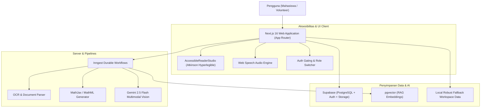

# SONAR — Accessible Course Materials for Blind Students

<div align="center">
  
  
  <p align="center">
    <strong>Beautiful for the eyes. Effortless for the ears.</strong><br />
    Platform web inovatif yang merekonstruksi materi perkuliahan dalam format PDF (termasuk pindaian, rumus matematika, dan diagram visual) menjadi dokumen digital terstruktur, dapat dinavigasi, serta 100% kompatibel dengan pembaca layar (screen reader) dan teknologi asistif.
  </p>

  <p align="center">
    <a href="https://nextjs.org"></a>
    <a href="https://react.dev"></a>
    <a href="https://www.typescriptlang.org"></a>
    <a href="https://tailwindcss.com"></a>
    <a href="https://supabase.com"></a>
    
  </p>
</div>

---

## 📑 Daftar Isi
- [Latar Belakang & Nilai Utama](#-latar-belakang--nilai-utama)
- [Fitur Utama Produk](#-fitur-utama-produk)
- [Hierarki Tipografi & Desain Brand](#-hierarki-tipografi--desain-brand)
- [Katalog Mata Kuliah & Shared Materials](#-katalog-mata-kuliah--shared-materials)
- [Peran Pengguna & Alur Kerja](#-peran-pengguna--alur-kerja)
- [Arsitektur Sistem](#-arsitektur-sistem)
- [Tech Stack](#-tech-stack)
- [Panduan Instalasi & Menjalankan Aplikasi](#-panduan-instalasi--menjalankan-aplikasi)
- [Konfigurasi Environment Variables](#-konfigurasi-environment-variables)
- [Perintah Verifikasi & Pengujian](#-perintah-verifikasi--pengujian)
- [Struktur Direktori Proyek](#-struktur-direktori-proyek)
- [Kebijakan Aksesibilitas & Keamanan](#-kebijakan-aksesibilitas--keamanan)

---

## 🌟 Latar Belakang & Nilai Utama

Mahasiswa tunanetra dan *low vision* di perguruan tinggi sering mengalami hambatan signifikan saat mengakses materi kuliah dalam format PDF. Modul pembelajaran dan salindia kuliah sering kali berupa:
1. Hasil pindaian (*scanned pages*) atau foto ponsel tanpa lapisan teks asli.
2. Rumus matematika dan kalkulus yang disematkan sebagai gambar tanpa deskripsi LaTeX/MathML.
3. Tabel data kompleks tanpa struktur baris dan kolom yang terasosiasi.
4. Diagram teknis, pohon struktur data, dan grafik tanpa teks deskripsi taktil.
5. Dokumen minim struktur heading sehingga tidak dapat dinavigasi menggunakan tombol pintas *screen reader*.

**SONAR** memecahkan masalah ini dengan mentransformasikan PDF mentah melalui alur pemrosesan AI multimodal, ekstraksi OCR, rekonstruksi MathML semantik, dan verifikasi manusia oleh volunteer reviewer. Dokumen yang telah disetujui dapat **digunakan kembali (*reusable*)** oleh seluruh mahasiswa yang terdaftar dalam mata kuliah yang sama dengan pelacakan versi sumber yang ketat (*source-version tracking*).

---

## 🚀 Fitur Utama Produk

### 1. Accessible Document Reader Studio (Ala Bookmind)
* **Canvas Membaca Inklusif:** Didesain khusus menggunakan font *Atkinson Hyperlegible* dan palet *warm paper* bebas silau.
* **Audio Reader Terintegrasi:** Kontrol pemutaran suara Web Speech API dengan kecepatan adaptif (0.75x hingga 2.0x), tombol lompat antar bagian, dan highlight blok aktif.
* **Semantic MathML Rendering:** Rumus matematika diuraikan menjadi MathML semantik yang terbaca jernih di screen reader (NVDA, JAWS, VoiceOver) serta dilengkapi teks narasi fonetik berbahasa Indonesia.
* **Deskripsi Visual Taktil:** Diagram dan visualisasi (misal: pohon biner AVL) dilengkapi narasi taktil berlapis.
* **Tanya AI (Document Assistant RAG):** Panel asisten dokumen cerdas dengan sitasi halaman akurat dan *chips* pertanyaan instan (*Ringkas Bab Ini*, *Jelaskan Rumus MathML*, *Poin Kunci Ujian*, *Buat Kuis Latihan*).

### 2. Unggah Dokumen Akademik (Ala ZeroEssay)
* Formulir pengunggahan terstruktur dengan deteksi mata kuliah, jenjang akademik (S1/S2), dan bahasa materi.
* **Pengaturan Izin Eksplisit:** Pilihan antara *Dokumen Pribadi* (hanya untuk konsumsi akun sendiri) atau *Ajukan Review Volunteer & Bagikan Se-Kelas* (masuk antrean kurasi).
* Dropzone intuitif dengan indikator persentase unggah dan form instruksi khusus volunteer.

### 3. Antrean & Workbench Verifikasi Volunteer (Ala Reviews Overview & Linkora)
* **Dashboard Metrik Kurasi:** Total ulasan, skor akurasi (4.8/5.0), bar distribusi rating, dan filter status (*Menunggu Review*, *Sedang Ditinjau*, *Perlu Perbaikan*, *Disetujui/Reusable*).
* **Checklist Audit 5 Langkah:** Panduan langkah demi langkah (1. OCR, 2. Headings, 3. Tables, 4. MathML, 5. Figures).
* **Live MathML & Audio Tester:** Inspector interaktif untuk menyunting kode LaTeX, melihat rendering MathML, dan menguji suara narasi audio sebelum disetujui.

### 4. Perpustakaan Materi Kuliah Bersama (Shared Reusable Library)
* Mengeliminasi duplikasi pekerjaan: materi yang telah diaudit oleh volunteer dapat langsung digunakan oleh mahasiswa tunanetra lainnya di kelas yang sama.
* **Source-Version Tracking:** Menjamin transparansi versi (`v2.1`, `v1.2`), catatan volunteer, serta alert otomatis apabila dosen mengunggah materi versi terbaru.

---

## 🎨 Hierarki Tipografi & Desain Brand

| Kategori | Font Family | Peruntukan Utama |
| :--- | :--- | :--- |
| **Heading & Branding** | `Plus Jakarta Sans` | Logo, identitas brand, seluruh elemen heading (`h1` s.d. `h6`), dan navigasi utama. |
| **User Interface** | `Poppins` | Subheading, judul kartu, tombol (*button*), badges status, kontrol tab, dan chips interaktif. |
| **Accessibility Reading** | `Atkinson Hyperlegible` | Mode membaca, canvas materi kuliah, pratinjau teks, dan konten pembelajaran beresolusi tinggi. |

### Palet Warna Resmi (Kontras Tinggi & Ramah Aksesibilitas)
* **Deep Teal (`#087E78`):** Warna primer identitas brand SONAR untuk tombol utama, tautan aktif, dan aksen fokus.
* **Fresh Aqua (`#39B9A7`):** Aksen sekunder dinamis dan tombol primer pada dark mode.
* **Periwinkle Blue (`#668FE8` / `#3D5FBF`):** Aksen highlight MathML, indikator sistem, dan peran administrator.
* **Warm Peach (`#F1A27E`):** Sorotan kutipan editorial, status volunteer reviewer, dan kartu metrik.
* **Warm Gold (`#F2D477`):** Banner kemitraan kampus, rating bintang, dan peringatan pembaruan versi sumber.
* **Soft Mint (`#E5F2EC`):** Permukaan sekunder, badge mahasiswa, dan latar bagian interaktif.
* **Warm Paper (`#FAF8F2`):** Latar belakang utama bebas silau yang nyaman untuk keterbacaan jangka panjang.
* **Deep Charcoal Ink (`#293B39`):** Teks utama berkontras tinggi (11.1:1 di atas Warm Paper) serta warna dasar footer.

---

## 📚 Katalog Mata Kuliah & Shared Materials

SONAR dirancang untuk mendukung 3 mata kuliah terstruktur:

| Kode Kelas | Nama Mata Kuliah | Contoh Dokumen Reusable | Status Verifikasi |
| :--- | :--- | :--- | :--- |
| **CS 201** | Struktur Data dan Algoritma | Modul 04 — Binary Search Trees & AVL Balancing | `Verified v2.1` |
| **CS 201** | Struktur Data dan Algoritma | Slide 07 — Graph Traversal: BFS dan DFS | `Verified v1.0` |
| **MATH 105** | Kalkulus Multivariabel & Aljabar Linier | Bab 03 — Turunan Parsial dan Matriks Hessian | `Verified v1.2` |
| **MATH 105** | Kalkulus Multivariabel & Aljabar Linier | Ringkasan Formula UTS Kalkulus Multivariabel | `Verified v1.0` |
| **STAT 210** | Teori Probabilitas & Inferensi Statistik | Handout 02 — Distribusi Probabilitas Diskrit & Kontinu | `Verified v2.0` |

---

## 👥 Peran Pengguna & Alur Kerja

Aplikasi memfasilitasi 2 peran operasional utama (ditambah peran Administrator) yang dapat dicoba secara instan melalui bilah samping (*Role Switcher*):

1. **Mahasiswa Tunanetra & Low Vision (Ahmad Fauzi):**
   * Masuk ke dashboard dan melanjutkan bacaan materi.
   * Membaca menggunakan pembaca layar atau pemutar audio internal.
   * Berinteraksi dengan RAG AI untuk memperdalam pemahaman konsep dan rumus.
   * Mengakses materi *reusable* yang telah diverifikasi rekan sekelas.
   * Mengunggah dokumen PDF baru dan meminta bantuan verifikasi volunteer.

2. **Volunteer Reviewer (Dewi Sartika, S.Kom.):**
   * Mengambil dokumen dari antrean peninjauan (*Review Queue*).
   * Memeriksa akurasi teks hasil OCR terhadap visual pindaian asli.
   * Menyunting formula matematika dan memastikan MathML terbaca tepat.
   * Menambahkan deskripsi taktil pada diagram atau grafik visual.
   * Memberikan persetujuan publikasi agar dokumen berstatus *Reusable*.

3. **Platform Administrator (Dr. Hendra Gunawan):**
   * Mengelola mata kuliah, pendaftaran kelas, dan hak akses.
   * Memantau antrean *job worker* pemrosesan dokumen.

---

## 🏗️ Arsitektur Sistem



---

## 🛠️ Tech Stack

* **Framework:** [Next.js 16 (App Router)](https://nextjs.org) dengan Partial Prerendering (PPR) dan Turbopack.
* **Core Library:** [React 19](https://react.dev)
* **Bahasa:** [TypeScript 5.9](https://www.typescriptlang.org) (Strict Mode)
* **Styling & Komponen:** [Tailwind CSS v4](https://tailwindcss.com), `@radix-ui`, `lucide-react`, `sonner`
* **Animasi:** [GSAP](https://gsap.com)
* **Database & Auth:** [Supabase](https://supabase.com) (PostgreSQL, Auth, Storage, Row-Level Security, pgvector)
* **Durable Execution:** [Inngest](https://www.inngest.com)
* **Mesin Matematika:** [MathJax Full](https://mathjax.org) & [KaTeX](https://katex.org)
* **Pengujian:** [Vitest](https://vitest.dev), [Testing Library](https://testing-library.com), [Playwright](https://playwright.dev), `@axe-core/playwright`

---

## ⚡ Panduan Instalasi & Menjalankan Aplikasi

### Prasyarat
* [Node.js](https://nodejs.org/) versi `v20.x` atau lebih baru
* Package manager `npm` versi `v10.x` atau lebih baru
* Git

### Langkah Instalasi
1. **Clone Repositori:**
   ```bash
   git clone <URL-REPOSITORI-ANDA>
   cd SONAR
   ```

2. **Pasang Dependensi:**
   ```bash
   npm install
   ```

3. **Konfigurasi Environment Variables:**
   Salin file template `.env.example` menjadi `.env.local`:
   ```bash
   cp .env.example .env.local
   ```
   *(Catatan: Aplikasi dapat langsung berjalan penuh dengan data demo interaktif lokal meskipun kunci API eksternal belum diisi)*.

4. **Jalankan Development Server:**
   ```bash
   npm run dev
   ```
   Buka peramban Anda di [http://localhost:3000](http://localhost:3000).

---

## 🔑 Konfigurasi Environment Variables

File template [.env.example](.env.example) menyediakan seluruh variabel yang dibutuhkan saat menghubungkan ke cloud:

```ini
# Application URL
NEXT_PUBLIC_APP_URL=http://localhost:3000

# Supabase (PostgreSQL + pgvector + Auth + Storage)
NEXT_PUBLIC_SUPABASE_URL=https://your-project-ref.supabase.co
NEXT_PUBLIC_SUPABASE_PUBLISHABLE_KEY=your-supabase-publishable-key
SUPABASE_SERVICE_ROLE_KEY=your-supabase-service-role-key

# AI Integration (Google Gemini Multimodal)
GOOGLE_GENERATIVE_AI_API_KEY=your-gemini-api-key
AI_PROVIDER=google
AI_CHAT_MODEL=gemini-2.5-flash
AI_VISION_MODEL=gemini-2.5-flash
AI_EMBEDDING_MODEL=gemini-embedding-001

# Background Processing Workflows (Inngest)
INNGEST_EVENT_KEY=your-inngest-event-key
INNGEST_SIGNING_KEY=your-inngest-signing-key
```

> **Keamanan Kredensial:** File `.env.local` dan seluruh berkas `.env*` yang memuat kredensial nyata dilindungi secara ketat oleh aturan `.gitignore` dan tidak akan pernah terdorong ke repositori Git publik.

---

## 🧪 Perintah Verifikasi & Pengujian

Aplikasi telah divalidasi dan memenuhi standar pengujian ketat sebelum dirilis:

```bash
# 1. Pengecekan tipe data TypeScript secara menyeluruh
npm run typecheck

# 2. Audit kualitas kode & aksesibilitas JSX (ESLint)
npm run lint

# 3. Menjalankan unit tests (PDF Validator, RAG Chunker, MathML Narration)
npm run test

# 4. Melakukan kompilasi production build Next.js
npm run build

# 5. Menjalankan audit aksesibilitas otomatis Playwright + axe-core (WCAG 2.2 AA)
npm run test:a11y
```

---

## 📁 Struktur Direktori Proyek

```text
SONAR/
├── .agents/                 # Standar skills agen dan pedoman desain
├── docs/                    # Dokumentasi arsitektur & panduan aksesibilitas
├── public/
│   ├── brand/               # Master asset logo resmi SONAR
│   └── images/              # Gambar Pixabay dengan alt text deskriptif
├── src/
│   ├── app/                 # Next.js 16 App Router (Marketing, Auth, Workspace)
│   │   ├── (auth)/          # Rute login & registrasi dengan demo switcher
│   │   ├── (marketing)/     # Landing page publik berestetika tinggi
│   │   ├── (reviewer)/      # Antrean review & workbench kurasi volunteer
│   │   ├── (student)/       # Dashboard, katalog mata kuliah, reader, & upload
│   │   └── api/             # API routes (Chat RAG, MathML preview, Upload)
│   ├── components/          # Komponen UI modular
│   │   ├── accessibility/   # Toolbar aksesibilitas, live announcer, skip links
│   │   ├── document/        # AccessibleReaderStudio (3 kolom ala Bookmind)
│   │   ├── documents/       # UploadForm (ala ZeroEssay)
│   │   ├── layout/          # AppShell, WorkspaceShell, navigasi terproteksi
│   │   └── reviewer/        # ReviewQueueTable, ReviewWorkbench (ala Linkora)
│   ├── features/            # Logika fitur domain (audio, auth, documents)
│   ├── lib/                 # Utility, data workspace fallback, & alt text gambar
│   ├── stores/              # State management preferences membaca
│   └── types/               # Definisi tipe data TypeScript database & skema
├── supabase/                # Skema migrasi SQL & database PostgreSQL
├── tests/                   # Pengujian unit Vitest & audit a11y Playwright
├── .env.example             # Template variabel lingkungan aman
├── .gitignore               # Proteksi ketat file rahasia/kredensial
├── next.config.ts           # Konfigurasi Turbopack & CSP Next.js
├── package.json             # Manifest paket dependensi
└── tsconfig.json            # Konfigurasi TypeScript ketat
```

---

## 🛡️ Kebijakan Aksesibilitas & Keamanan

* **Desain Ramah Pembaca Layar:** Seluruh elemen interaktif memiliki label yang dapat diakses, kontras warna teruji, navigasi keyboard penuh, serta hierarki heading tunggal yang logis.
* **Screen Reader First:** Setiap tombol kontrol pemutar suara dan blok konten dilengkapi atribut ARIA yang tepat (`aria-live`, `aria-atomic`, `role="region"`, `role="status"`).
* **Perlindungan Data Mahasiswa:** Akses materi perkuliahan terisolasi per mata kuliah dengan izin berbasis *Row-Level Security* (RLS). Mahasiswa hanya dapat mengakses materi pribadi atau materi bersama yang telah lolos peninjauan volunteer.

---

<div align="center">
  <p>Dikembangkan dengan ❤️ untuk menciptakan pendidikan tinggi yang setara, mandiri, dan inklusif bagi seluruh mahasiswa tunanetra.</p>
</div>
